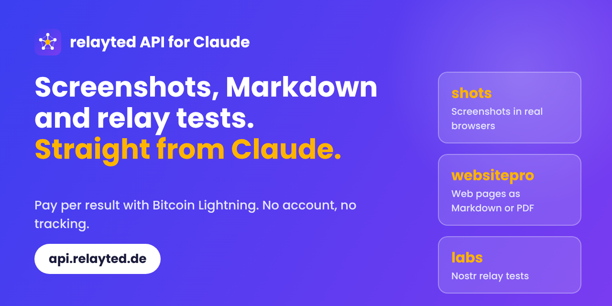

# relayted-api: Claude plugin



Use the [relayted API](https://api.relayted.de) straight from Claude Code:

- **shots**: screenshots of any public URL in real browsers (Chrome, Edge, Firefox, WebKit, Brave, Opera, mobile), several viewports, light and dark mode
- **websitepro**: a web page as Markdown, text, metadata, HTML or PDF
- **labs**: Nostr relay tests with a pass/fail report

Prepaid, per delivered result, paid with Bitcoin Lightning. No account, no subscription. Failed results are refunded automatically.

## Install

```
/plugin marketplace add relayted/api-plugin-claude
/plugin install relayted-api@relayted
```

## Set up (once)

1. Open <https://api.relayted.de/account>, top up (1 EUR is enough to try it) and create an API key.
2. Put the key into the environment variable `RELAYTED_API_KEY` and restart Claude Code.
   - Windows: `setx RELAYTED_API_KEY "<key>"`
   - macOS/Linux: `export RELAYTED_API_KEY="<key>"` in your shell profile

Requires Node 18 or newer. The key is only read from the environment and never printed.

## Use

Just ask Claude, for example:

- "Take a screenshot of example.com in Chrome and Firefox, light and dark."
- "Get https://example.com/docs as Markdown."
- "Test the Nostr relay wss://relay.example.com."
- "What is my relayted balance?"

## Cost protection

Every result costs real money, so the plugin has two brakes:

1. The skills tell Claude to get the free quote first, name the price and never start batches on its own.
2. The helper script enforces a limit: a job above 0.25 EUR is refused until you confirm. Change the limit with the environment variable `RELAYTED_MAX_EUR`.

## Files

```
.claude-plugin/   plugin and marketplace manifest
skills/           setup, shots, websitepro, labs
scripts/relayted.mjs   the helper (no dependencies)
```

API reference: <https://api.relayted.de/docs> · OpenAPI: <https://api.relayted.de/openapi.json> · MIT License
